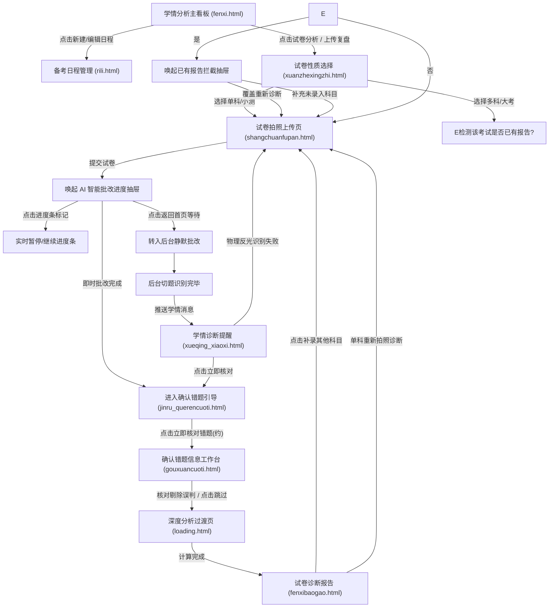

# 小苗伴学 · 9月版本 PRD 完整归档规范文档 (产品需求与原型设计)

> **线上原型演示总控 (PRD Hub)**: [https://tangyun.abrdns.com/](https://tangyun.abrdns.com/#page=fenxi)  
> **归档版本**: `V2.0 (9月迭代稳定版)`  
> **归档时间**: `2026-09-18 17:50:47`  
> **项目工程**: `9月版本 / yuanx_9`  
> **覆盖平台**: 移动端 H5 / App 内嵌 Webview (标准 375px / 390px 视口规范)

---

## 目录
1. [版本概述与业务背景](#一-版本概述与业务背景)
2. [全局设计规范与架构原则](#二-全局设计规范与架构原则)
3. [核心业务全景流转图](#三-核心业务全景流转图)
4. [全量页面功能与业务规则详细说明](#四-全量页面功能与业务规则详细说明)
   - [P01. 学情分析主看板 (fenxi.html)](#p01-学情分析主看板-fenxihtml)
   - [P02. 备考日程管理 (rili.html)](#p02-备考日程管理-rilihtml)
   - [P03. 试卷性质选择与拦截 (xuanzhexingzhi.html)](#p03-试卷性质选择与拦截-xuanzhexingzhihtml)
   - [P04. 试卷拍照与AI批改 (shangchuanfupan.html)](#p04-试卷拍照与ai批改-shangchuanfupanhtml)
   - [P05-1. 全科大考进入确认错题 (jinru_querencuoti.html)](#p05-1-全科大考进入确认错题-jinru_querencuotihtml)
   - [P05-2. 单科小测进入确认错题 (jinru_querencuoti_single.html)](#p05-2-单科小测进入确认错题-jinru_querencuoti_singlehtml)
   - [P06-1. 全科错题勾选与核对工作台 (gouxuancuoti.html)](#p06-1-全科错题勾选与核对工作台-gouxuancuotihtml)
   - [P06-2. 单科错题勾选与核对工作台 (gouxuancuoti_single.html)](#p06-2-单科错题勾选与核对工作台-gouxuancuoti_singlehtml)
   - [P07. 深度学情计算过渡页 (loading.html)](#p07-深度学情计算过渡页-loadinghtml)
   - [P08. 试卷诊断分析报告 (fenxibaogao.html)](#p08-试卷诊断分析报告-fenxibaogaohtml)
   - [P09. 学情诊断提醒消息流 (xueqing_xiaoxi.html)](#p09-学情诊断提醒消息流-xueqing_xiaoxihtml)
5. [多考生家庭隔离与数据防呆机制](#五-多考生家庭隔离与数据防呆机制)
6. [异常处理与容错规则汇总](#六-异常处理与容错规则汇总)

---

## 一. 版本概述与业务背景

### 1.1 业务背景与痛点
1. **认知断层痛点**：用户上传试卷后，原系统直接由切题跳往分析报告，导致用户不知道系统圈出的错题是否精准；或者在后台静默批改时，用户以为已经出报告，实际上处于待核对状态。
2. **多科大考木桶效应**：期中、期末、月考等大型考试涉及语文、数学、英语、物理等多门科目。原有逻辑要求全科上传且全科成功才能核对，导致任一科目卡住（如拍照反光）全流程停滞。
3. **多考生家庭隔离缺失**：针对多孩家庭，既需要按考生分别建立独立的学情档案与考试复盘，又需要在全家日程中总览各考生的备考节点。
4. **日程与考前复盘脱节**：日程仅充当备忘录，未与学情分析系统中的历史错题和考前查漏补缺联动。

### 1.2 本期核心交付目标
- **流水线式错题核对**：引入「进入确认错题中转抽屉」+「极速勾选错题工作台」，将核对动作前置并解耦。
- **异步部分就绪体验**：多科上传支持“部分科目就绪先行核对”，失败科目独立告警重传。
- **大考已有报告拦截防呆**：同一考试再次录入时，智能识别已有报告，提供“覆盖重传”与“补录未上传科目”双通道。
- **全局消息触达闭环**：在学情消息中心建立完整的卡片生命周期追踪。

---

## 二. 全局设计规范与架构原则

1. **视口与布局标准**：
   - 移动端基于标准 375×812 / 390×844 设备画板设计，左右安全边距 16px，卡片圆角 12px~16px。
   - 悬浮底部操作栏（Bottom Fixed Dock）统一采用 16px 安全垫底与纯白毛玻璃/卡片投影。
2. **交互色彩系统**：
   - **品牌主色**：`#3388FF`（科技蓝，用于主按钮、导航激活高亮）
   - **正向成功/就绪**：`#10B981` / `#05FFD5`（用于已就绪状态、正确题标记）
   - **异常警示/待核对**：`#F59E0B`（用于疑难错题、待核对提示、修改标注）
   - **错误/失败/危险**：`#EF4444`（用于解析失败、删除警示、下线功能）
   - **中性灰底与分割线**：背景 `#F8FAFC`，分割线 `#E2E8F0`，次要字体 `#64748B`。
3. **ProtoHub 跨端互通机制**：
   - 全局通过 `safeProtoNavigate(...)` 统一调度路由，支持 URL 参数与 `localStorage` 上下文无缝共享。

---

## 三. 核心业务全景流转图

---

## 四. 全量页面功能与业务规则详细说明

### P01. 学情分析主看板 (`fenxi.html`)

- **线上路由**: `#page=fenxi` （[点击直接访问在线原型](https://tangyun.abrdns.com/#page=fenxi)）
- **功能所属分类**: 1. 核心看板与数据总览
- **业务定位**: 多考生学情总览、近期大考与小测看板、弱项知识点分布与快捷进入复盘入口。

#### 1. 界面元素与交互逻辑
- **考生档案切换**：支持顶部快速切换多考生身份（如「张小晓 · 高2」、「张二宝 · 初3」），看板卡片与成绩趋势图即时刷新。
- **多考生深链返回上下文自适应与视觉反馈**：
  - 当通过诊断报告页（`fenxibaogao.html`）返回或直达主看板（携带 `?student=张小晓&fromReport=1`）时，系统自动识别并平滑切换当前选中考生为目标考生（张小晓 · 高2）。
  - 顶部考生选择器触发 0.8s 呼吸微动效高亮（`studentSwitchBreath`），同时弹出轻量 Toast 提示：`已为您切换至【张小晓·高2】学情看板`，杜绝静默篡改造成家长数据误读。
- **最新备考看板**：展示距下一次重点考试倒计时天数（如期中考试倒计时 2 天），无日程时展示「添加考试日程」空态卡片。
- **学情雷达与成绩走势**：展示六维学科竞争力雷达模型及月度提分曲线。
- **历史复盘入口**：列表化展示近期模考、小测卡片，点击直跳试卷诊断报告（`fenxibaogao.html`）。

#### 2. 原型标注与业务规则规范 (Annotations)

| 序号 | 类型 | 标注标题 | 关联 DOM 锚点 | 核心业务规则与细节 |
| :--- | :--- | :--- | :--- | :--- |
| **1** | `原有` | **新用户默认日程** | `#app div.esc-light-col` | 当前无任何日程时，展示默认日程：“日程标题"： 建立首个考试日程， “日程类型"： 其它， “关联类型"： 不选 当用户无最近日程，但存在历史日程时暂时原有的”暂无“界面 |
| **2** | `新增` | **多考生深链返回自适应** | `#app div.student-selector` | 从诊断报告页返回时，根据入参智能对齐当前考生身份，伴随胶囊呼吸微动效与 Toast 提示，保障多孩数据上下文绝对清晰。 |

---

### P02. 备考日程管理 (`rili.html`)

- **线上路由**: `#page=rili` （[点击直接访问在线原型](https://tangyun.abrdns.com/#page=rili)）
- **功能所属分类**: 2. 备考排程与日历看板
- **业务定位**: 多考生考试日程统一管理、日历月/周视图切换、考试日程编辑、删除防呆二次确认弹窗、考前复盘清单联动。

#### 1. 界面元素与交互逻辑
- **日历看板视图**：提供月视图与周视图平滑滑动切换，标记各考生大考、模考与随堂测节点。
- **多考生隔离筛选**：支持按孩子多选或单选，确保多孩家庭考试日程一目了然且数据隔离。
- **日程新建与编辑抽屉**：点击日程进入详情面板，提供编辑名称、日期、科目及考生勾选。
- **删除日程二次防呆确认弹窗 (日程与报告解耦)**：
  - **解耦核心原则**：日程与考试诊断分析报告深度剥离。删除日程仅清理日历视图排期备忘，绝不级联硬删除已生成的考试诊断报告。
  - **已有诊断报告日程**：弹出解耦防呆确认弹窗，明确告知家长报告安全：“确定删除该日程？删除后将不再展示在日历中，已生成的 **[学生名]** 考试分析报告仍完好保留在‘学情分析’中。”提供 `[ 取消 ]` 与 `[ 确认删除 ]`。确认后 Toast 提示：“已删除日程”。
  - **普通待考日程**：常规轻量确认，提示“确定删除该日程？删除后该日程将不再展示在日历中。”

#### 2. 原型标注与业务规则规范 (Annotations)

| 序号 | 类型 | 标注标题 | 关联 DOM 锚点 | 核心业务规则与细节 |
| :--- | :--- | :--- | :--- | :--- |
| **1** | `原有` | **编辑日程** | `#app div.sheet-card` | 字段 场景 A：所有关联考生均无报告 场景 B：部分或全部关联考生已有报告 说明 日程标题 / 备注 允许修改 允许修改 属于文案展示 日程日期 允许修改 允许修改（同步更新报告时间） 考试日程时间调整也属于常见场景 日程类型 (大考/小测/其他) 允许自由切换 允许自由切换 属于日历展示分类 学生勾选列表 自由勾选/取消勾选 已生成报告的考生标识为已出报告（常驻选中不可取消，点击温和Toast提示不可移除），未生成报告的考生可自由增删 保护历史考生数据，同时允许增删其他考生 |
| **2** | `修改` | **删除日程说明 (解耦轻量确认)** | `#app div.modal-card > div:nth-of-type(2) > button:nth-of-type(2)` | 1. **解耦规则（核心规范）**：删除日程仅清理日历视图中的排期备忘，彻底与考试诊断分析报告解耦。 2. **弹窗确认逻辑**：采用极简标准防呆确认（“确认删除该日程？删除后该日程将不再展示在日历中”），提供 `[ 取消 ]` 与 `[ 确认删除 ]`。不向用户抛出多余的技术解耦说教，符合主流日历交互直觉。 3. **数据独立性**：删除日程不会改变学情分析中的任何统计指标（均分、错题总数等），报告管理权责完整收拢于学情档案详情页。 4. **Toast 反馈**：“已删除日程，考试分析报告已归档在学情分析中”。 |
| **3** | `新增` | **日程编辑与报告资产深度解耦规范** | `#editEvTitle` | 1. **单一职责规范**：日历排期仅维护时间管理与备考备忘，修改日程标题仅作用于日历事件本身，彻底与试卷诊断报告资产解耦。 2. **零副作用**：日历改名严禁副作用篡改已归档的诊断报告，避免家长私密备忘污染严肃学情档案。 3. **指针引用**：日历卡片通过外键指针链接直达对应报告，不搞脆弱的同名强绑定。 | 1. **双向对等原则**：与诊断报告修改考试名称对称，编辑日程修改标题时，若关联考生存在已生成诊断报告，动态感知展示「同步修改关联试卷诊断报告名称」复选框。 2. **精准具名**：文案精准展示已生成报告的具体考生姓名（如“张小晓”），多孩场景清晰隔离。 3. **自选授权**：勾选保存则日程与报告大标题一并同步，不勾选保存则仅修改日历备忘；无任何已出报告时静默隐藏，严密防呆。 |

---

### P03. 试卷性质选择与已有报告拦截 (`xuanzhexingzhi.html`)

- **线上路由**: `#page=xuanzhexingzhi` （[点击直接访问在线原型](https://tangyun.abrdns.com/#page=xuanzhexingzhi)）
- **功能所属分类**: 3. 试卷上传与录入准备
- **业务定位**: 区分「多科 / 大考」与「单科 / 小测」，支持已有报告拦截检测与补录未录入科目流转。

#### 1. 界面元素与交互逻辑
- **考试性质双模选择**：
  - **「多科 / 大考」**：适用于期中、期末、模考等全科综合考试，支持多科目打包录入并计算综合总分与竞争力雷达。
  - **「单科 / 小测」**：适用于随堂测验、单元测试，单科极速诊断。
- **智能日程高情商推荐与主动关联（核心防呆机制）**：
  - **非强迫默认绑定**：选定日期后，若命中当日备考日程，系统不默认强行绑定（避免随堂小测被误绑进期中大考）。
  - **高情商主动推荐卡片**：展示“发现当日有备考日程，是否关联？”，提供 `[ 一键关联 ]` 胶囊按钮及多日程切换。
  - **主动采纳闭环**：用户主动点击【一键关联】后，转为已关联态并自动同步考试类型（大考/小测）。仅在主动关联且该日程已有历史报告时，下一步才会唤起拦截抽屉。
  - **独立试卷零误杀**：用户若不理会推荐，默认按独立试卷处理，自由选择大考/小测直接进入拍照，彻底避免误伤。
- **已有报告拦截抽屉**：
  - 仅针对用户明确关联或选定已有报告的大考时触发。
  - **路径 A · 补录未录入科目**：保留已有科目成绩，定向补充尚未录入的科目。
  - **路径 B · 查看已有报告**：直接查看该场考试的完整诊断报告。

#### 2. 原型标注与业务规则规范 (Annotations)

| 序号 | 类型 | 标注标题 | 关联 DOM 锚点 | 核心业务规则与细节 |
| :--- | :--- | :--- | :--- | :--- |
| **1** | `修改` | **智能日程推荐与已有报告拦截** | `#app div.intercept-sheet-title` | 1. **高情商主动推荐**：检测到当日日程时，默认展示推荐卡片（“发现当日有备考日程，是否关联？”），用户主动点击【一键关联】才进行绑定，避免日常随堂小测被大考日程误伤。 2. **拦截触发前提**：仅当用户主动关联了已有报告的考试日程时，点击下一步才唤起拦截抽屉。 3. **拦截操作项**：提供【补未录入科目】（定向补充漏传科目）与【查看已有报告】。未关联日程时正常流转，零误杀阻断。 |
| **2** | `原有` | **多科/单科说明** | `#typeOptionSmall` | 原大小考更名为：「多科 / 大考」与「单科 / 小测」 「多科 / 大考」与「单科 / 小测」可勾选，同新建日程的编辑规则与日程同步更新 |

---

### P04. 试卷拍照与AI批改工作台 (`shangchuanfupan.html`)

- **线上路由**: `#page=shangchuanfupan` （[点击直接访问在线原型](https://tangyun.abrdns.com/#page=shangchuanfupan)）
- **功能所属分类**: 4. 试卷图片采集与后台批改
- **业务定位**: 各科目多张试卷拍照上传、AI 智能批改进度抽屉、切题进度条暂停/标记机制、后台静默批改引导。

#### 1. 界面元素与交互逻辑
- **科目分栏卡片**：横向或竖向展示语、数、英、物等多科试卷采集区，支持拍照、相册多选及角标删除。
- **AI 智能批改进度抽屉与暂停机制**：
  - 点击“开始分析”后唤起底部渐变进度抽屉，展示切题与 OCR 实时流转效果。
  - **交互特色**：点击切题进度条可**实时暂停/继续进度**，支持讲演演示或慢速核验。
  - **后台批改引导**：提供「返回首页等待（后台持续批改）」按钮，点击后试卷转入服务端静默队列，不卡死用户前台界面。

#### 2. 原型标注与业务规则规范 (Annotations)

| 序号 | 类型 | 标注标题 | 关联 DOM 锚点 | 核心业务规则与细节 |
| :--- | :--- | :--- | :--- | :--- |
| **1** | `原有` | **AI批改解析抽屉与后台持续批改** | `#gradingSheetPanel div.gsp-progress-track` | 批改解析中状态与业务交互规则： 解析动画与进度条反馈： 试卷上传后自动拉起半屏抽屉，展示 AI 解析动态光效与实时进度条（点击标注或进度条可随时暂停/恢复，便于演示评审）。 离线/后台批改机制： 用户可随时点击「返回首页等待（后台持续批改）」，系统转入静默后台处理，不阻塞用户其他操作；批改完成后在首页最新日程与通知栏同步推送结果。 自动流转确认： 进度达 100% 后自动平滑流转进入「确认错题」页面（gouxuancuoti.html）。 |

---

### P05. 确认错题引导 (核对中枢页)

本模块按**全科大考**与**单科小测**两种场景完全物理拆分独立页面呈现：

#### P05-1. 全科大考进入确认错题 (`jinru_querencuoti.html`)
- **线上路由**: `#page=jinru_querencuoti`
- **业务定位**: 多科目大考（如期末考试周）离线批改完成后的核对中枢页。
- **界面与交互规范**:
  - **顶部导航**: 彻底取消右上角「跳过」按钮；试卷名称支持铅笔图标重命名（未命名时默认兜底规则为 `[MM月DD日]综合大考`，彻底摒弃「未命名考试」）。
  - **价值提示条**: 强调“已完成初筛，错题已圈选。核对错题，报告诊断准确率可提升至 99%！”，去除消极跳过与 AI 概念。
  - **4 步流转指示器**: `[✓ 上传试卷] ➔ [✓ 切题解析] ➔ [● 核对错题] ➔ [○ 学情报告]`。
  - **彻底隐藏默认学科**: 大考不展示默认学科条，杜绝信息冗余。
  - **科目卡片列表**: 动态列出各就绪科目（语文 2 题待复核、数学 5 题待复核等），点击各科「核对错题 >」直接跳入 P06 工作台，自动定位该学科 Tab。
  - **吸底操作反转 (与单科保持一致)**:
    - **主推强 CTA**: 突出高亮绿色主按钮 `核对错题 ➔`（锚点 `#app button.btn-sheet-main`），驱动用户主动核对。
    - **兜底弱化入口**: 在主按钮下方保留一行极轻中性灰字链接 `暂不核对，直接生成诊断报告`，保持出口闭环同时不抢夺注意力。

#### P05-2. 单科小测进入确认错题 (`jinru_querencuoti_single.html`)
- **线上路由**: `#page=jinru_querencuoti_single`
- **业务定位**: 随堂小测/单门科目批改完成后的专属核对引导中枢页。
- **界面与交互规范**:
  - **顶部导航**: 彻底取消右上角「跳过」按钮，消除逃生出口与决策干扰；保留左侧返回与考试名称自定义编辑（默认规则为 `[MM月DD日]单科[科目]`）。
  - **价值提示条**: 强调“已完成初筛，错题已圈选。核对错题，报告诊断准确率可提升至 99%！”，杜绝主动诱导跳过的消极文案，不刻意强调 AI 概念。
  - **单科识别与科目聚合大卡**: 将「默认科目」与「识别统计」深度合并为一张结构化大卡。卡头左侧呈现「默认科目」标签与「科目切换胶囊 `[数学 ▾]`」（支持轻点唤起抽屉自由切换），去除多余的 AI 徽标；卡片下方结构与大考科目卡片完全对齐，呈现「共发现 N 道错题，待复核」与「核对错题 >」直达工作台按钮。
  - **吸底操作反转 (聚焦业务转化)**:
    - **主推强 CTA**: 突出高亮大主按钮 `核对错题 ➔`（绿色品牌渐变，锚点 `#app button.btn-sheet-main`），驱动用户主动核对。
    - **兜底弱化入口**: 在主按钮下方保留一行极轻中性灰字链接 `暂不核对，直接生成诊断报告`，既保证赶时间用户的出口闭环，又彻底避免与主目标竞争视觉焦点。

#### 原型标注与业务规则规范 (Annotations)

| 序号 | 关联页面 | 标注标题 | 关联 DOM 锚点 | 核心业务规则与细节 |
| :--- | :--- | :--- | :--- | :--- |
| **1** | `jinru_querencuoti.html` | **大考全科核对说明** | `#app button.btn-sheet-main` | 全科大考完成批改后引导用户复核多科错题。标出 4 步流转状态，吸底以「核对错题」为主推，弱化直接出报告，支持逐科跳转 P06 并自动定位科目 Tab。 |
| **2** | `jinru_querencuoti.html` | **核对阶段修改考试名称与日程联动** | `#renameSheet` | 核对中转页提供卷头标题修正抽屉，支持纠正 AI 识别有误的卷头名，并支持同步更新关联日程选项，更新后自动级联传递至出具的诊断报告中。 |
| **2** | `jinru_querencuoti_single.html` | **单科识别与核对聚合引导** | `#paperMetaHubCard` | 单科随堂小测模式下核心提供学科切换与错题复核卡片（共发现 N 道错题，待复核 + 核对错题按钮），吸底以「核对错题」为主推，弱化直接生成，有效引导用户复核提高报告精准度。 |

---

### P06-1. 全科错题勾选与核对工作台 (`gouxuancuoti.html`)

- **线上路由**: `#page=gouxuancuoti` （[点击直接访问在线原型](https://tangyun.abrdns.com/#page=gouxuancuoti)）
- **功能所属分类**: 6. 错题核对操作工作台 (全科大考)
- **业务定位**: 多科目大考批改后的多学科聚合核对工作台。支持顶部常驻多科目 Tab（自动激活目标学科）、试卷原图预览、疑难错题纠偏（正确/错误/半对）、吸底生成大考全涵盖诊断报告。

#### 1. 界面元素与交互逻辑
- **全科多科目 Tab 切换**：
  - 顶部常驻多科目 Tab（如 `[ 语文 · 错2题 ]` `[ 数学 · 错5题 ]`），从 P05-1 全科中枢点入时**自动激活选中目标学科**；
  - 允许在当前页面轻点或手势滑动直接切换其他科目，核对完毕直接在底部点击「生成大考诊断报告 (N科全涵盖)」，杜绝来回返回套娃。
- **错题切片核验卡片**：
  - 顶部提供试卷原图横幅与「查看试卷原图」大图预览；
  - 自动圈出初筛疑难错题（橙色高亮），正确题以绿色展示，支持轻点题号在「正确 / 错误 / 半对」间翻转纠偏，并打上「修正」小标签。
- **跳过与结算逻辑**：
  - 顶部右上角保留「跳过」轻链接，赶时间用户可直接生成报告；吸底主按钮为「生成大考诊断报告 (N科全涵盖)」。

---

### P06-2. 单科错题勾选与核对工作台 (`gouxuancuoti_single.html`)

- **线上路由**: `#page=gouxuancuoti_single` （[点击直接访问在线原型](https://tangyun.abrdns.com/#page=gouxuancuoti_single)）
- **功能所属分类**: 6. 错题核对操作工作台 (单科小测独立页面)
- **业务定位**: 随堂小测/单门科目专属的极简专注错题核对工作台。彻底解耦并剥离多科目 Tab 栏，避免信息干扰与空间挤压。

#### 1. 界面元素与交互逻辑
- **彻底去除多科目 Tab 栏**：纯粹单屏单科，消除多学科视觉噪点与空间占用。
- **标题栏默认科目与切换胶囊**：
  - 在标题栏以显眼可交互胶囊标出 **`默认科目: [ 数学 ▾ ]`**（与 P05-2 术语绝对统一）；
  - 用户轻点胶囊可直接拉起半屏抽屉，自由切换所属科目（数/语/英/物/化/生），切换后题面与学情上下文自适应重载。
- **试卷切片与 22 题圆形矩阵**：
  - 试卷切片原图 Cover +「查看试卷原图」弹窗预览；
  - 22 道题 6 列标准圆形宫格对齐，正确（绿色）、错误（橙色）、半对（对角渐变），轻点快速翻转纠偏并标记「修正」。
- **吸底单一强行动点**：
  - 吸底按钮固定为 **`直接生成诊断报告`**，点击即刻保存修正数据并平滑进入过渡页出报告。

#### 2. 原型标注与业务规则规范 (Annotations)

| 序号 | 关联页面 | 标注标题 | 关联 DOM 锚点 | 核心业务规则与细节 |
| :--- | :--- | :--- | :--- | :--- |
| **1** | `gouxuancuoti.html` | **跳过说明** | `#app button.btn-header-skip` | 用户可点击右上角跳过错题核对流程，直接按初筛结果计算生成学情报告。 |
| **2** | `gouxuancuoti_single.html` | **跳过核对说明** | `#app button.btn-header-skip` | 赶时间的用户可点击右上角跳过，直接按初筛疑难错题结果生成诊断报告。 |
| **3** | `gouxuancuoti_single.html` | **单科默认科目切换** | `#btnChangeSubjPill` | 单科随堂小测场景下，在顶部直接标明默认科目，点击唤起底部抽屉自由切换科目，无多科 Tab 干扰。 |
| **4** | `gouxuancuoti_single.html` | **单科错题核对矩阵** | `#paperCardSingle` | 展示试卷切片与 22 道题圆形数字矩阵。支持点按在绿色、橙色、半对状态间即时翻转纠偏，自动标记「修正」。 |
| **5** | `gouxuancuoti_single.html` | **直接生成诊断报告** | `#btnSubmitGenerate` | 单科核对完毕后，吸底呈现强 CTA「直接生成诊断报告」，保存当前修正数据并直通报告生成。 |

---

### P07. 深度学情计算与过渡态 (`loading.html`)

- **线上路由**: `#page=loading` （[点击直接访问在线原型](https://tangyun.abrdns.com/#page=loading)）
- **功能所属分类**: 7. 报告计算过渡态
- **业务定位**: 核对错题后的 AI 算法运算加载动画，展示知识图谱关联、提分空间测算等加载进度动效。

#### 1. 界面元素与交互逻辑
- **分析计算动态展示**：展示“正在生成多维竞争力雷达图”、“正在匹配高频错因知识图谱”、“正在测算提分诊断潜力”等动态微文案。
- **耗时预期**：前端维持 1.5~2.5 秒自然缓冲后自动平滑跳转至最终报告页。

#### 2. 原型标注与业务规则规范
*本页面作为核心流转链路节点，遵循全局数据流与路由规范。*

---

### P08. 试卷学情诊断报告 (`fenxibaogao.html`)

- **线上路由**: `#page=fenxibaogao` （[点击直接访问在线原型](https://tangyun.abrdns.com/#page=fenxibaogao)）
- **功能所属分类**: 8. 学情报告与诊断呈现
- **业务定位**: 多科大考总分与综合雷达图、各单科得分率与薄弱考点、单科重新诊断（拍照反光/模糊重新上传）、补录未录入科目入口。

#### 1. 界面元素与交互逻辑
- **多科综合雷达图**：展示多科总分、年级排位测算以及学科强弱项雷达图。
- **单科下钻卡片**：各科目展示卷面得分、错题列表、薄弱知识点标签。
- **重新诊断（覆盖重传）**：单科卡片右上方提供「重新诊断」按钮，点击带参数跳回上传页定向重传。
- **补录未录入科目**：底部提供「补充未录入科目」入口，直通补充录入模式，解锁完整大考雷达。
- **多考生身份显性透出**：顶部标题栏显著标注考生姓名胶囊（如 `[👤 张小晓 · 高2]`），杜绝多孩家庭错看学情。
- **双出口闭环路由与堆栈截断**：
  - **来源敏感返回键（`<`）**：
    - 若来源为消息中心待办（`from=msg`），返回至 `xueqing_xiaoxi.html?finished=1`，触发待办卡片自愈闭环；
    - 若来源为日常上传或主看板，返回至主看板并带入对应考生参数（`fenxi.html?student=张小晓&fromReport=1`）。
  - **吸底直达主看板（主 CTA）**：底部常驻强行动点「查看 张小晓 完整学情看板」，点击直跳对应考生的学情总览看板。
  - **加载过渡页堆栈截断**：前置过渡页 `loading.html` 使用 `window.location.replace` 跳转，彻底消除点击返回重新掉入 loading 计算动画的死循环陷阱。

#### 2. 原型标注与业务规则规范 (Annotations)

| 序号 | 类型 | 标注标题 | 关联 DOM 锚点 | 核心业务规则与细节 |
| :--- | :--- | :--- | :--- | :--- |
| **1** | `原有` | **重新诊断说明** | `#app button.btn-re-diagnose-pill` | 覆盖与合并规则： 仅允许重新上传该单科的试卷。 诊断完成后，仅覆盖替换该科目的分析数据。 其余科目的保持不变。 |
| **2** | `原有` | **补录科目说明** | `#app div.subj-tab-item.add-tab-btn` | 界面展示规则： 自动过滤并隐藏已完成诊断的科目。 仅展示当前未上传的科目卡片（例如语文、数学已上传，则仅显示英语、物理、化学、生物）。 顶部进度条与统计显示：待补充科目：N 科。 提交规则：提交后，仅对新补充的科目进行分析，完成后自动合并进该次考试。 |
| **3** | `新增` | **双出口路由与考生归位** | `#app .bottom-actions-wrap` | 底部提供「查看 [考生名] 完整学情看板」，顶部返回键具备来源感知逻辑；离开报告不论走哪条路径，均保障考生上下文精准对应，杜绝认知断层。 |
| **4** | `规范` | **报告顶部标题高保真规范 (图二还原)** | `.main-page-title` | 试卷诊断报告顶部导航大标题严格保持标准化业务主标题「试卷诊断报告」，右上附「AI解读」高光徽标与日期副标题（如“周六 10/10”），不作为考试名称重命名入口；考试名称的自定义与重命名操作前置归属于图一（学情分析试卷卡片及录题核对入口），保持诊断报告资产的严肃性与统一视觉规范。 |

---

### P09. 学情诊断提醒消息流 (`xueqing_xiaoxi.html`)

- **线上路由**: `#page=xueqing_xiaoxi` （[点击直接访问在线原型](https://tangyun.abrdns.com/#page=xueqing_xiaoxi)）
- **功能所属分类**: 9. 消息中心与触达闭环
- **业务定位**: 后台批改并发完成后的双消息分流（错题识别完成·待核对错题 / 错题识别失败·重新拍照）、待办卡片自愈流转、日程临近提醒、历史报告查看。

#### 1. 界面元素与交互逻辑
- **时间线消息卡片流**：按日期（如 2026年08月27日、08月20日）倒序组织诊断消息。
- **错题识别完成 · 待核对错题卡片与自愈机制**：
  - 未核对时：文案清晰说明数学、英语已就绪，物理仍在处理中，底部行动点为「立即核对 >」；
  - 核对完成自愈态：当用户核对完成由报告页返回（`finished=1`），卡片自动流转为「错题已核对 · 诊断报告已生成 (已完成)」，行动点自动变更为「查看分析报告」，形成有始有终的任务自愈闭环。
- **错题识别失败卡片**：
  - 红色警示标题，明确交代“物理因试卷强光反光或折痕遮挡识别失败”。
  - 底部操作「重新上传 >」，点击直跳物理单科重新拍照上传，单科失败不阻断其他科目。
- **考前复盘与日程临近卡片**：
  - 距离大考 2 天时自动推送考前重点复盘建议，直跳日程页。

#### 2. 原型标注与业务规则规范 (Annotations)

| 序号 | 类型 | 标注标题 | 关联 DOM 锚点 | 核心业务规则与细节 |
| :--- | :--- | :--- | :--- | :--- |
| **1** | `新增` | **错题识别完成·待核对错题提醒** | `#msgCardVerify` | 部分科目错题识别完成先行核对机制： 触发时机： 多科大考并发处理中，数学、英语已率先完成 AI 切题与错题识别（共 11 道错题），物理因识别失败待重新上传。 异步解耦价值： 用户可立即点击核对已就绪科目错题，失败科目不阻断正常科目流转。 操作跳转： 点击「立即核对」进入核对中转弹窗与错题勾选工作台。 |
| **2** | `新增` | **错题识别失败·重新拍照上传提醒** | `#msgCardFailed` | 单科识别异常与独立重拍机制： 触发时机： 物理试卷因强光反光遮挡或折痕导致题干识别失败。 异常隔离： 仅物理单科告警重拍，不影响已识别就绪的数学、英语核对与报告生成。 一键重传： 点击「重新上传」直跳试卷上传页物理重传，无需重新配置其他正常科目。 |
| **3** | `新增` | **待办卡片状态自愈流转** | `#msgCardVerify` | 当用户核对完成并返回消息中心时，待办卡片自动由“待核对”流转为“已完成”，主按钮变更为“查看分析报告”，避免用户困惑于残留待办。 |

---

## 五. 多考生家庭隔离与数据防呆机制

1. **考生档案唯一标识**：
   - 所有的试卷上传上下文（`uploadContext`）、错题记录、诊断报告及日程，均绑定唯一的 `studentId` 与 `studentName`（如“张小晓 · 高2”）。
   - 在消息中心卡片、核对错题抽屉、诊断报告头部均强透出考生姓名，防止多孩家长发生混淆。
2. **多考生上下文顺势切换与提示**：
   - 当家长在不同链路（如从“张小晓”的诊断报告跳回主看板）时，主看板自动对齐当前考生身份为张小晓，配合胶囊呼吸动效与 Toast 提示，保障数据阅读的绝对确信感。
3. **已有诊断报告大考防重复录入**：
   - 相同考生在同一场大考（如“高二上学期期中考试”）下已生成报告时，系统强制拦截，提供“补录未录入科目”或“覆盖重测”，坚决杜绝脏数据重复生成。
4. **日程删除与报告解绑校验**：
   - 当用户在日程中尝试删除一场已有诊断报告的考试时，明确告知已生成报告安全完好保留在学情分析中，删除仅移除日历排期，消除家长误删顾虑。
   - 当用户在日程中尝试删除一场已有诊断报告的考试时，必须经过二级模态弹窗强警告，告知解除关联影响后方可执行。

---

## 六. 异常处理与容错规则汇总

| 异常场景 | 表现与触发条件 | 系统处理与容错策略 | 对应页面与恢复出口 |
| :--- | :--- | :--- | :--- |
| **试卷强光反光 / 模糊** | 拍照反光遮挡题干，AI OCR 无法精准识别题面 | 判定为「错题识别失败」，触发红色告警消息卡片，说明失败原因（反光/折痕），保留其他正常科目数据 | 消息中心卡片 ➔ 点击「重新上传」直达单科重拍 |
| **多科试卷部分完成** | 语数英物 4 门中，数学英语先跑完，物理耗时较长 | 启动**异步流水线核对机制**，推送「部分科目已就绪」消息，用户可先进去核对数学英语，不等物理 | 点击消息 ➔ [jinru_querencuoti.html](https://tangyun.abrdns.com/#page=jinru_querencuoti) |
| **大考科目未录全** | 期中考仅上传了语数，缺英语物理 | 诊断报告页展示已有科目分析，在雷达图与底部常驻「补录未录入科目」引导，补全后自动合成全科总分 | 诊断报告页 ➔ 点击「补充科目」|
| **误判题面勾选** | AI 笔迹识别将部分正确题目初筛为错题 | 在错题核对工作台中，所有题目均支持单击一键反转，用户 内即可剔除误判 | [gouxuancuoti.html](https://tangyun.abrdns.com/#page=gouxuancuoti) |
| **用户赶时间跳过核对** | 用户在核对页不愿逐题确认 | 页面右上角常驻「跳过」操作，系统自动采用 AI 默认初筛结果直接生成学情报告 | 点击右上角「跳过」直接进 [loading.html](https://tangyun.abrdns.com/#page=loading) |

---

## 七. 归档结论与在线验证

- **线上演示总入口**: [https://tangyun.abrdns.com/](https://tangyun.abrdns.com/#page=fenxi)
- **代码仓库**: `github.com/tang11012003/bm-show` (Branch: `gh-pages`)
- **独立域名绑定**: `tangyun.abrdns.com` (内嵌根目录 `CNAME` 文件，确保未来任何一次推送均不被覆盖)
- **交付结论**: 本版本已完整贯穿“日程规划 ➔ 试卷采集 ➔ 智能切题 ➔ 错题核验 ➔ 学情诊断 ➔ 消息闭环”全生命周期链路，符合业务验收与工程归档标准。
